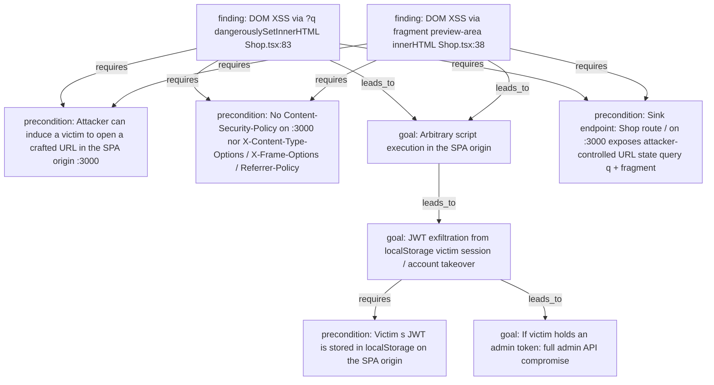

**DRAFT — requires pentester review before any use.**
# swarmy session report

Target: http://127.0.0.1:3001/

Scope allowlist: domain=localhost, ip_subnet=127.0.0.1/32, port=3000, port=3001, scheme=http
Period: 2026-11-27T01:50:07.974364+00:00 → 2026-11-27T01:56:26.147833+00:00 (UTC, journal span)

## Summary

| Metric | Value |
|---|---|
| Endpoints recorded | 36 |
| Findings total | 5 |
| Findings verified | 2 |
| Attack-tree components | 1 |
| Journal events | 75 |

Journal events by type:

- AttackTreeUpdated: 20
- EndpointsDiscovered: 36
- FindingCandidate: 5
- FindingRejected: 2
- FindingVerified: 4
- OperatorMessage: 1
- TargetSet: 1
- TaskCompleted: 3
- TaskRequested: 3

## Findings

### [HIGH] Reflected DOM XSS in ShopVault SPA: q query parameter rendered via dangerouslySetInnerHTML (unescaped) (verified)

- **Id:** #2 · **Type:** xss · **Status:** verified · **Severity:** high- **CVSS vector:** `CVSS:3.1/AV:N/AC:L/PR:N/UI:R/S:C/C:H/I:L/A:N`- **Endpoint:** GET / (127.0.0.1:3000)- **Recorded by:** xss-detector

Reflected DOM-based XSS in the ShopVault SPA. Address-bar query parameter \`q\` is written into innerHTML with no escaping.

Data flow (all hops verified by GET against the dev server; source recovered verbatim from the served module's inline sourcemap):
  index.html → /src/main.tsx (root render) → /src/App.tsx (\`&lt;Route path="/" element={&lt;Shop/&gt;} /&gt;\`) → /src/pages/Shop.tsx.
  Source: /app/src/pages/Shop.tsx:83 \`Search results for: &lt;span dangerouslySetInnerHTML={{ __html: searchParams.get("q") \|\| "" }} /&gt;\`
  searchParams = react-router-dom useSearchParams() → URLSearchParams.get("q") → percent-decoded attacker string.
  Sink: React dangerouslySetInnerHTML → node.innerHTML (raw HTML parse, by design no escaping).
No sanitizer (no DOMPurify/allowlist; file imports only react, react-router-dom, api/client, CartContext). No Content-Security-Policy header on :3000. Value lands as element content of a &lt;span&gt;, so plain markup parses without any attribute breakout.

Severity rationale (high): script execution in the origin of the SPA; the API client stores the JWT in localStorage (src/api/client.ts reads localStorage "token" → Authorization: Bearer) so XSS yields session/account takeover, and the app ships an /admin area reachable with an admin token. Victim interaction (opening a crafted link) required.

IMPORTANT — client-side vs server-side distinction: \`GET /?q=&lt;marker&gt;\` returns the byte-identical 850-byte SPA shell with no trace of the value (evidence 95; analyze_reflection verdict: reflected=false). That is expected for a client-rendered SPA and is NOT disproof — the vulnerability lives in the client-side render, which the browser performs from the served modules above.

Proof is deliberately NON-EXECUTING: no &lt;script&gt;, no javascript: URL, no event handler, no network callback. The only claim proven is that attacker text reaches the HTML parser as markup, unescaped.

Status is \`verified\` on source-level data-flow grounds (static proof of a sink with an unconditional raw-HTML contract); no JS was executed in a browser during this session.

Reproduction steps:

1. NON-EXECUTING PROOF — nothing below runs code, opens a network request, or reads any user data. It only proves the input reaches the HTML parser as markup.
2. 1. Fetch the code the browser actually runs: GET http://127.0.0.1:3000/src/pages/Shop.tsx (200, text/javascript). Confirm line 83: &lt;span dangerouslySetInnerHTML={{ __html: searchParams.get("q") \|\| "" }} /&gt;. Confirm the load chain GET / → /src/main.tsx → /src/App.tsx (\`&lt;Route path="/" element={&lt;Shop/&gt;} /&gt;\`) so route "/" renders this component.
3. 2. Visit (or load in any browser) http://127.0.0.1:3000/?q=%3Cb%20id%3Dxssmark1%3Ezqx1%3C%2Fb%3E  — the decoded value is the inert markup: &lt;b id="xssmark1"&gt;zqx1&lt;/b&gt;
4. 3. Expected result: the 'Search results for:' alert renders a BOLD element containing 'zqx1'. In devtools console run: document.getElementById('xssmark1') → returns the injected &lt;b&gt; element (non-null). That is the full proof: attacker text was parsed as HTML.
5. 4. Stronger (context-break) variant, same sink, still inert: http://127.0.0.1:3000/?q=%22%3E%3Ci%20id%3Dxssmark2%3Ezqx2%3C%2Fi%3E → decoded value: "&gt;&lt;i id=xssmark2&gt;zqx2&lt;/i&gt; — document.querySelector('i#xssmark2') becomes non-null.
6. 5. Contrast/control: GET http://127.0.0.1:3000/?q=svxq992b99294307695e returns the byte-identical 850-byte SPA shell with the marker absent (no server-side reflection). This is expected for a client-rendered SPA and does not affect the finding.
7. 6. Do NOT escalate to an executing payload on this engagement: the non-executing markers above already prove the missing escaping. If code execution must be shown, get explicit operator approval first.
Evidence (raw artifacts in the session folder):

- [evidence #86](evidence/b2a78789d00c41c48410a2fe5528ad2f/request.txt) — http_request_response
- [evidence #87](evidence/e4895397b7334fc49800d71e2069e94f/request.txt) — http_request_response
- [evidence #88](evidence/eba6f3db494e4eb5b2cc2a7a04384754/request.txt) — http_request_response
- [evidence #89](evidence/7f30ea54f08943bba75d7522ea6ae5cc/request.txt) — http_request_response
- [evidence #95](evidence/3023cf5131024475bffd7c5812dbec2c/request.txt) — http_request_response

### [MEDIUM] DOM XSS via URL fragment (#) assigned to #preview-area innerHTML in ShopVault SPA (verified)

- **Id:** #1 · **Type:** xss · **Status:** verified · **Severity:** medium- **CVSS vector:** `CVSS:3.1/AV:N/AC:L/PR:N/UI:R/S:C/C:H/I:L/A:N`- **Endpoint:** GET / (127.0.0.1:3000)- **Recorded by:** xss-detector

DOM-based XSS via the URL fragment on the ShopVault SPA home page. The fragment (everything after '#') is copied into innerHTML on mount with no escaping.

Data flow (verified by GET; source from the served module's inline sourcemap):
  Source: /app/src/pages/Shop.tsx:34 \`const hash = window.location.hash.slice(1);\`
  Sink:   /app/src/pages/Shop.tsx:38 \`el.innerHTML = hash;\`  where el = document.getElementById("preview-area")
  The &lt;div id="preview-area"&gt; is rendered by the same component (line 87) and is already committed to the DOM when the mount useEffect fires, so the element is always found and the assignment always happens.

No sanitizer, no decoding, no allowlist between fragment and innerHTML. No Content-Security-Policy header on :3000. Delivery: the attacker gets the victim to open http://127.0.0.1:3000/#&lt;markup&gt; (link, redirect page, window.location) — the fragment is parsed as HTML.

Honest limitation (not a mitigation): browsers do not percent-decode location.hash, so \`#&lt;b id=x&gt;y&lt;/b&gt;\` works but \`#%3Cb%3E\` stays inert text — the payload must be placed as literal characters in the fragment.

Severity rationale (medium): technical impact is identical to the ?q= finding (script execution in the SPA origin, JWT in localStorage → account takeover, /admin area reachable with an admin token), but the exploitation surface is slightly narrower: the fragment is never transmitted to the server, so the vector cannot be chained through server-side redirects, logging, or Referer leakage and cannot be delivered by anything but a direct link/JS navigation. Hence medium rather than high despite equal technical impact.

Proof is deliberately NON-EXECUTING (no &lt;script&gt;, no javascript: URL, no event handler, no network callback). Status \`verified\` on source-level data-flow grounds; no JS was executed in a browser during this session.

Reproduction steps:

1. NON-EXECUTING PROOF — no code execution, no network callback, no event handler is involved.
2. 1. GET http://127.0.0.1:3000/src/pages/Shop.tsx and confirm the mount effect: \`const hash = window.location.hash.slice(1); if (hash) { const el = document.getElementById("preview-area"); if (el) { el.innerHTML = hash; } }\` and the sink element \`&lt;div id="preview-area"&gt;\` in the same component.
3. 2. Open in a browser: http://127.0.0.1:3000/#&lt;b id="xssmark3"&gt;zqx3&lt;/b&gt;  (literal characters in the fragment; percent-encoded forms stay inert because location.hash is not decoded).
4. 3. Expected result: the product list page renders plus a bold element containing 'zqx3' above the product grid, injected into #preview-area. Devtools check: document.getElementById('xssmark3') → non-null.
5. 4. Attribute-context variant, still inert: http://127.0.0.1:3000/#"&gt;&lt;i id=xssmark4&gt;zqx4&lt;/i&gt; → document.querySelector('i#xssmark4') non-null.
6. 5. Control: GET http://127.0.0.1:3000/#&lt;b id=xssmark3&gt;zqx3&lt;/b&gt; with curl returns the identical 850-byte shell (fragments are never sent to the server). Expected; the sink is purely client-side and this is not disproof.
7. 6. Do not escalate to executing payloads on this engagement; the inert markers already prove the missing escaping.
Evidence (raw artifacts in the session folder):

- [evidence #87](evidence/e4895397b7334fc49800d71e2069e94f/request.txt) — http_request_response
- [evidence #88](evidence/eba6f3db494e4eb5b2cc2a7a04384754/request.txt) — http_request_response
- [evidence #89](evidence/7f30ea54f08943bba75d7522ea6ae5cc/request.txt) — http_request_response
- [evidence #95](evidence/3023cf5131024475bffd7c5812dbec2c/request.txt) — http_request_response

### [HIGH] Stored XSS render sink: product review comments are rendered with dangerouslySetInnerHTML on the product page (candidate)

- **Id:** #5 · **Type:** xss · **Status:** candidate · **Severity:** high- **CVSS vector:** `CVSS:3.1/AV:N/AC:L/PR:L/UI:R/S:C/C:H/I:L/A:N`- **Endpoint:** GET /product/{id} (127.0.0.1:3000)- **Recorded by:** xss-detector

Render-path analysis (no data written - read-only session): every review comment returned by the API is injected as raw HTML on the product detail page. /src/pages/ProductDetail.tsx line 105:

    reviews.map((review) =&gt; ( ... &lt;p dangerouslySetInnerHTML={{ __html: review.comment }} /&gt; ... ))

The data comes from GET /api/products/{id}, whose model is {"reviews":\[{"id","rating","comment","created_at","user_name"}]} (see /api/products/1). The only writer of review.comment is POST /api/reviews {product_id, rating, comment} (endpoint 4), which any authenticated shopper can call - the UI exposes it to every logged-in user on the product page. No sanitisation exists on the API side (comments are stored and re-served verbatim as JSON) and no CSP is returned, so a stored comment becomes script in the origin of every visitor of that product page, including admins. JWT is in localStorage -&gt; session/account takeover.

Status: the sink and the taint source are both proven by reading served source and API data over GET; what is NOT proven (and cannot be proven without a write) is an actual malicious stored comment. Current data is benign (product 1 review comment is plain prose; product 2 has no reviews), so this is recorded as a candidate awaiting an authorized write test on POST /api/reviews.

Reproduction steps:

1. GET http://127.0.0.1:3000/src/pages/ProductDetail.tsx and read line 105: &lt;p dangerouslySetInnerHTML={{ __html: review.comment }} /&gt; inside reviews.map(...).
2. GET http://127.0.0.1:3001/api/products/1 - the \`reviews\[].comment\` field is served verbatim as JSON from the same object the UI renders; /api/products/2 shows an empty reviews array.
3. GET http://127.0.0.1:3001/api/products - no review content is sanitised anywhere; API content-type is application/json and values are JSON-encoded only (no HTML escaping contract stated).
4. Write path (NOT executed - out of this read-only mandate): authenticated POST /api/reviews {product_id: 1, rating: 5, comment: &lt;inert markup&gt;} then GET http://127.0.0.1:3000/product/1 in a browser to observe the comment parsed as HTML.
5. Impact: stored script runs for every visitor of the affected product page (incl. admins viewing it) and can read the JWT from localStorage; no CSP to mitigate.
Evidence (raw artifacts in the session folder):

- [evidence #106](evidence/24820c4cc851457d90c69f022406641e/request.txt) — http_request_response
- [evidence #120](evidence/9edfd3d8568c4dcfa6fda1e5c12c84d2/request.txt) — http_request_response
- [evidence #89](evidence/7f30ea54f08943bba75d7522ea6ae5cc/request.txt) — http_request_response

### [HIGH] DOM-based reflected XSS on the Shop page via ?q= (dangerouslySetInnerHTML) (rejected)

- **Id:** #3 · **Type:** xss · **Status:** rejected · **Severity:** high- **CVSS vector:** `CVSS:3.1/AV:N/AC:L/PR:N/UI:R/S:C/C:H/I:L/A:N`- **Endpoint:** GET / (127.0.0.1:3000)- **Recorded by:** xss-detector

The Shop page takes the \`q\` query parameter straight out of the URL and assigns it as raw HTML. /src/pages/Shop.tsx (served read-only from the Vite dev server) contains, at line 83:

    Search results for: &lt;span dangerouslySetInnerHTML={{ __html: searchParams.get("q") \|\| "" }} /&gt;

\`searchParams\` comes from react-router's useSearchParams(), i.e. it is fully attacker-controlled from location.search. React's dangerouslySetInnerHTML performs no sanitisation or encoding, so any markup in ?q= becomes live DOM on load, for anonymous visitors too.

Why this is a real sink and not a false positive:
- The port-3000 server is a static Vite dev server: GET /?q=&lt;marker&gt; returns the byte-identical 850-byte index.html (same ETag) and the marker does not appear in the response (analyze_reflection: reflected=false). There is therefore no server-side escaping layer between the URL and the JS.
- No CSP is returned on index.html or on /src/** (and no X-Content-Type-Options / X-Frame-Options), so injected inline handlers/elements are not mitigated.
- AuthProvider keeps the JWT in localStorage ("token"), so script execution in this origin yields session token theft -&gt; account takeover, and admin pages (/admin/users, /admin/orders) become reachable with an admin token.

Note on method: this is a read-only assignment, so no executing payload was ever sent; verification is by source-level data flow (attacker-controlled location.search -&gt; dangerouslySetInnerHTML, no sanitiser, no CSP), plus the proven absence of server-side reflection/sanitisation.

Reproduction steps:

1. GET http://127.0.0.1:3000/src/pages/Shop.tsx and read around line 83: &lt;span dangerouslySetInnerHTML={{ __html: searchParams.get("q") \|\| "" }} /&gt; inside the \`searchParams.get("q") &amp;&amp; (&lt;div className="alert alert-info"&gt;...)\` block.
2. GET http://127.0.0.1:3000/src/App.tsx: route path="/" element={&lt;Shop /&gt;} - the sink is on the default landing page.
3. GET http://127.0.0.1:3000/?q=zqxb52b27e18348e09e - response is the static 850-byte index.html, marker absent, no CSP header: confirms the server does not touch q, so the browser-side sink receives the raw value.
4. In a browser (not done here - read-only mandate), open http://127.0.0.1:3000/?q=&lt;inert-markup&gt; and observe the markup being parsed inside the 'Search results for:' alert instead of shown as text.
5. Impact chain: AuthProvider (src/context/AuthContext.tsx) stores the JWT in localStorage; script in this origin can read it and impersonate the victim, including the admin UI.
Evidence (raw artifacts in the session folder):

- [evidence #93](evidence/79e77951afe64347a470e91794273708/request.txt) — http_request_response
- [evidence #109](evidence/85c43b83391c4600bd8f52c8e9a20a63/request.txt) — http_request_response
- [evidence #121](evidence/c8bece1dc12d4d7994d612e18c532b83/request.txt) — http_request_response

### [HIGH] DOM-based XSS on the Shop page via the URL fragment written to innerHTML (#preview-area) (rejected)

- **Id:** #4 · **Type:** xss · **Status:** rejected · **Severity:** high- **CVSS vector:** `CVSS:3.1/AV:N/AC:L/PR:N/UI:R/S:C/C:H/I:L/A:N`- **Endpoint:** GET / (127.0.0.1:3000)- **Recorded by:** xss-detector

Second DOM sink in the same file: on mount, Shop reads the URL fragment and writes it into an element with innerHTML. /src/pages/Shop.tsx:

    useEffect(() =&gt; {
      const hash = window.location.hash.slice(1);
      if (hash) {
        const el = document.getElementById("preview-area");
        if (el) { el.innerHTML = hash; }
    }, \[]);

Nothing is encoded or sanitised; window.location.hash is fully attacker-controlled, and the target div (#preview-area) is rendered unconditionally by the same component. The write happens on first mount of the landing page, so a link of the form http://127.0.0.1:3000/#&lt;markup&gt; executes in the victim's origin as soon as they open it. No CSP is served, and the JWT lives in localStorage, so the impact equals session/account takeover.

Verification basis: source-level data flow read over GET (read-only session). The fragment is never sent to the server - GET http://127.0.0.1:3000/ returns the same static 850-byte shell regardless - so this cannot be demonstrated with curl-style probes; no executing payload was sent.

Reproduction steps:

1. GET http://127.0.0.1:3000/src/pages/Shop.tsx and locate the first useEffect: const hash = window.location.hash.slice(1); ... el.innerHTML = hash; (guarded only by document.getElementById("preview-area")).
2. GET http://127.0.0.1:3000/src/pages/Shop.tsx line ~87: &lt;div id="preview-area"&gt;&lt;/div&gt; is rendered unconditionally on the Shop route, so the lookup always succeeds.
3. GET http://127.0.0.1:3000/src/App.tsx confirms Shop is the element for path "/".
4. In a browser (not done here - read-only mandate): open http://127.0.0.1:3000/#&lt;inert-markup&gt; and observe it parsed into #preview-area.
5. Impact: JWT is in localStorage (src/context/AuthContext.tsx) -&gt; token theft and account takeover, no CSP to mitigate.
Evidence (raw artifacts in the session folder):

- [evidence #93](evidence/79e77951afe64347a470e91794273708/request.txt) — http_request_response
- [evidence #109](evidence/85c43b83391c4600bd8f52c8e9a20a63/request.txt) — http_request_response
- [evidence #121](evidence/c8bece1dc12d4d7994d612e18c532b83/request.txt) — http_request_response

## Attack trees

### Tree component rooted at node 1

Text rendering:

```text
[N1] precondition: Attacker can induce a victim to open a crafted URL in the SPA origin (:3000)
[N2] precondition: No Content-Security-Policy on :3000 (nor X-Content-Type-Options / X-Frame-Options / Referrer-Policy)
[N3] precondition: Victim's JWT is stored in localStorage on the SPA origin
[N4] finding: DOM XSS via ?q= → dangerouslySetInnerHTML (Shop.tsx:83)
[N5] finding: DOM XSS via #fragment → #preview-area innerHTML (Shop.tsx:38)
[N6] goal: Arbitrary script execution in the SPA origin
[N7] goal: JWT exfiltration from localStorage → victim session / account takeover
[N8] goal: If victim holds an admin token: full admin API compromise
[N9] precondition: Sink endpoint: Shop route "/" on :3000 exposes attacker-controlled URL state (query q + fragment)
[N4] --requires--> [N1]
[N4] --requires--> [N2]
[N5] --requires--> [N1]
[N5] --requires--> [N2]
[N4] --leads_to--> [N6]
[N5] --leads_to--> [N6]
[N6] --leads_to--> [N7]
[N7] --requires--> [N3]
[N7] --leads_to--> [N8]
[N4] --requires--> [N9]
[N5] --requires--> [N9]
```

Mermaid (subset per the template header note):



## Appendix: researched endpoints

| Id | Method | Path | Host | Status | Out of scope | Parameters |
|---|---|---|---|---|---|---|
| 1 | GET | /api/products/{id} | 127.0.0.1:3001 | probed | no |  |
| 2 | GET | /api/products/search | 127.0.0.1:3001 | probed | no | q(query) |
| 3 | GET | /api/products | 127.0.0.1:3001 | probed | no |  |
| 4 | POST | /api/reviews | 127.0.0.1:3001 | undiscovered | no | product_id(body), rating(body), comment(body) |
| 5 | POST | /api/auth/register | 127.0.0.1:3001 | undiscovered | no | email(body), password(body), full_name(body) |
| 6 | GET | /api/auth/me | 127.0.0.1:3001 | probed | no | Authorization(header) |
| 7 | POST | /api/auth/login | 127.0.0.1:3001 | undiscovered | no | email(body), password(body) |
| 8 | PUT | /api/profile | 127.0.0.1:3001 | undiscovered | no | full_name(body), email(body) |
| 9 | GET | /api/cart | 127.0.0.1:3001 | probed | no |  |
| 10 | POST | /api/cart/checkout | 127.0.0.1:3001 | undiscovered | no | items(body), shipping_address(body), cc_number(body), cc_expiry(body), cc_cvv(body), coupon_code(body) |
| 11 | GET | /api/orders/{id} | 127.0.0.1:3001 | probed | no | Authorization(header) |
| 12 | GET | /api/orders | 127.0.0.1:3001 | probed | no | Authorization(header) |
| 13 | PUT | /api/admin/products/{id} | 127.0.0.1:3001 | undiscovered | no | name(body), description(body), price(body), category(body), stock(body), image_url(body) |
| 14 | POST | /api/coupons/validate | 127.0.0.1:3001 | undiscovered | no | code(body) |
| 15 | GET | /api/admin/products | 127.0.0.1:3001 | probed | no | Authorization(header) |
| 16 | POST | /api/admin/products | 127.0.0.1:3001 | undiscovered | no | name(body), description(body), price(body), category(body), stock(body), image_url(body) |
| 17 | GET | /api/admin/users | 127.0.0.1:3001 | probed | no | Authorization(header) |
| 18 | DELETE | /api/admin/products/{id} | 127.0.0.1:3001 | undiscovered | no |  |
| 19 | GET | /api/admin/orders | 127.0.0.1:3001 | probed | no | user_id(query), status(query) |
| 20 | POST | /api/admin/import | 127.0.0.1:3001 | undiscovered | no | url(body) |
| 21 | GET | / | 127.0.0.1:3000 | probed | no | q(query) |
| 22 | GET | /checkout | 127.0.0.1:3000 | probed | no |  |
| 23 | GET | /cart | 127.0.0.1:3000 | probed | no |  |
| 24 | GET | /product/{id} | 127.0.0.1:3000 | probed | no |  |
| 25 | GET | /profile | 127.0.0.1:3000 | probed | no |  |
| 26 | GET | /orders | 127.0.0.1:3000 | probed | no |  |
| 27 | GET | /register | 127.0.0.1:3000 | probed | no |  |
| 28 | GET | /login | 127.0.0.1:3000 | probed | no |  |
| 29 | GET | /admin/users | 127.0.0.1:3000 | probed | no |  |
| 30 | GET | /admin/import | 127.0.0.1:3000 | probed | no |  |
| 31 | GET | /admin | 127.0.0.1:3000 | probed | no |  |
| 32 | GET | /vite.config.ts | 127.0.0.1:3000 | probed | no |  |
| 33 | GET | /src/main.tsx | 127.0.0.1:3000 | probed | no |  |
| 34 | GET | /admin/orders | 127.0.0.1:3000 | probed | no |  |
| 35 | GET | /package.json | 127.0.0.1:3000 | probed | no |  |
| 36 | GET | /admin/products | 127.0.0.1:3000 | probed | no |  |

---
*Generated deterministically by swarmy (arch §11) — no LLM-written text. Review before use.*
